# FootBook – Guide utilisateur

FootBook est une application web : elle s'utilise dans un navigateur d'ordinateur, sans installation, et reste utilisable sur tablette et téléphone (le menu se replie). Deux types de comptes : **joueur** et **propriétaire**.

## Créer un compte et se connecter

Sur l'accueil, cliquer sur *Créer un compte*, choisir **Joueur** ou **Propriétaire**, puis remplir prénom, nom, nom d'utilisateur, email et mot de passe (8 caractères minimum). Le compte est créé et l'on arrive sur le **tableau de bord**.

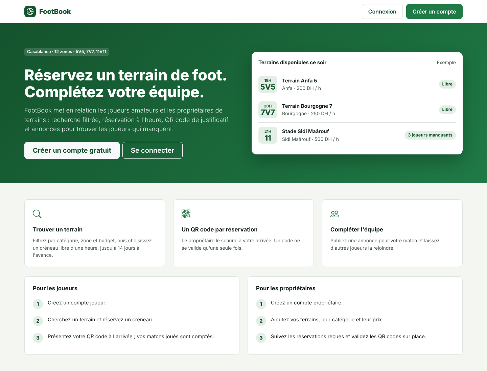
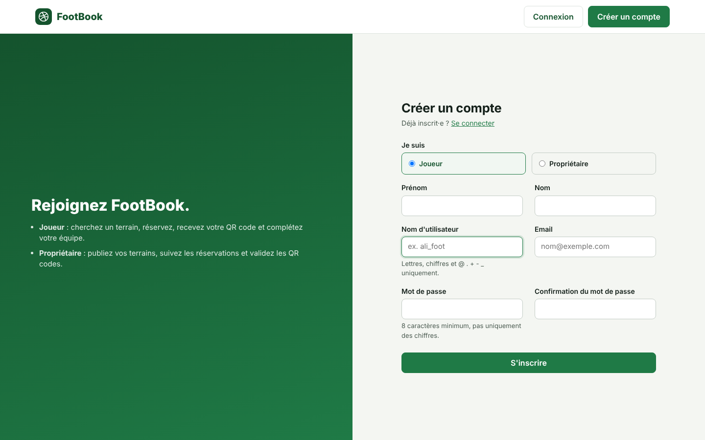

Le menu de gauche ne montre que les pages de votre rôle. *Déconnexion* est en bas du menu.

## Joueur

### Tableau de bord
Matchs joués, réservations à venir, annonces ouvertes, et la liste de vos prochains matchs avec leur QR code.

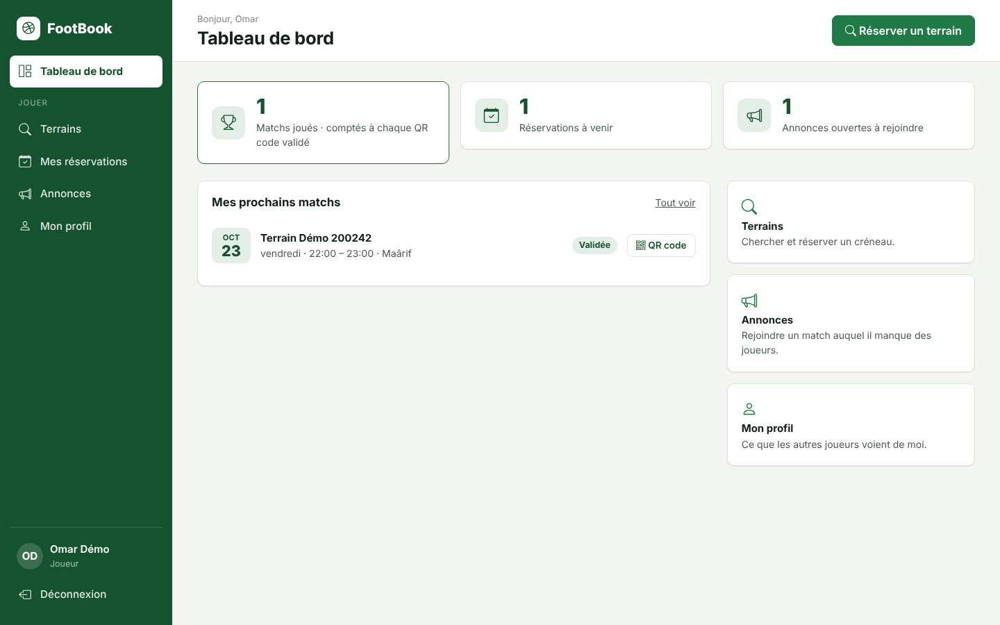

### Chercher un terrain et réserver
1. *Terrains* : filtrer par catégorie (5V5, 7V7, 11V11), zone et prix (DH par heure) dans le panneau de gauche. Les résultats sont triés du moins cher au plus cher.
2. *Réserver* sur la carte d'un terrain.
3. Choisir le jour (aujourd'hui à J+14), puis un créneau libre d'une heure (9:00 à 22:00) et *Confirmer la réservation*.

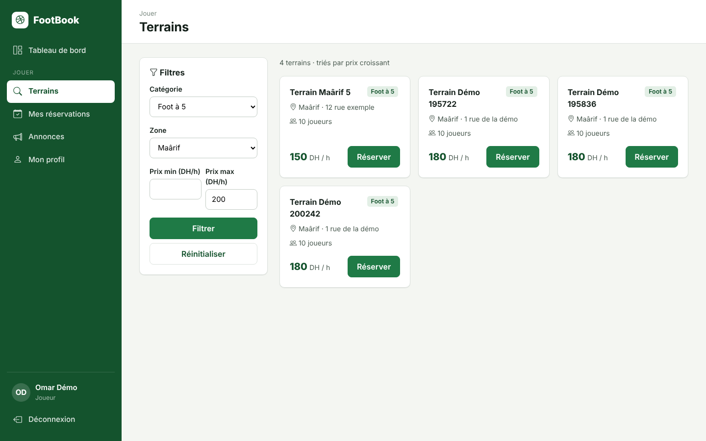
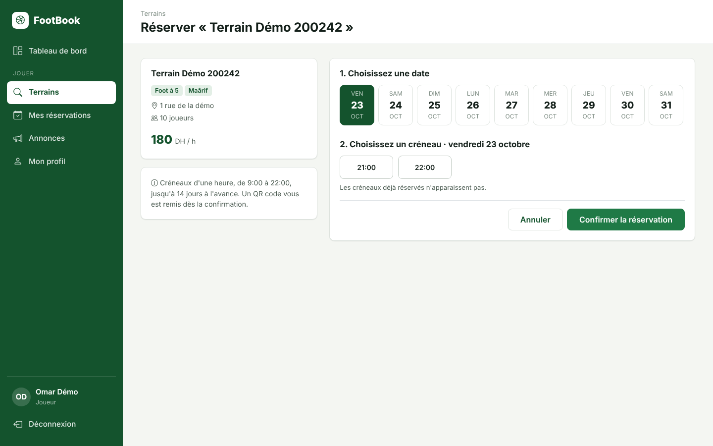

Si un autre joueur prend le créneau au même moment, un message vous invite à en choisir un autre : une réservation ne peut jamais être prise deux fois.

### QR code
Après la réservation, la page du QR code s'affiche. Présentez-le au propriétaire à votre arrivée. Le code texte sert si le scan ne marche pas. Le QR code reste accessible depuis *Mes réservations*, et seul vous pouvez le voir.

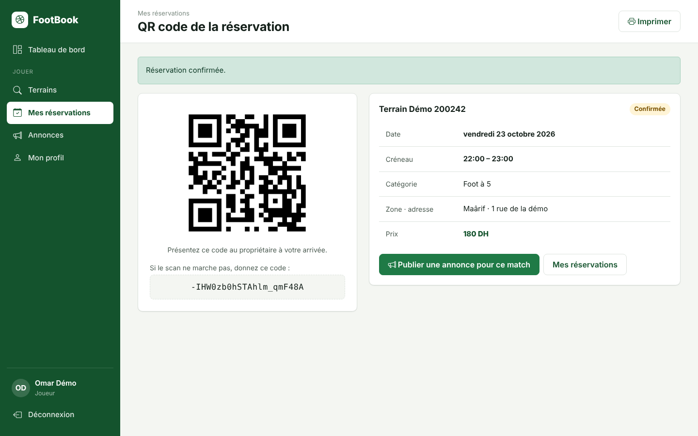

### Mes réservations
Deux tableaux : à venir et passées, avec le statut (*Confirmée*, puis *Validée* après le scan).

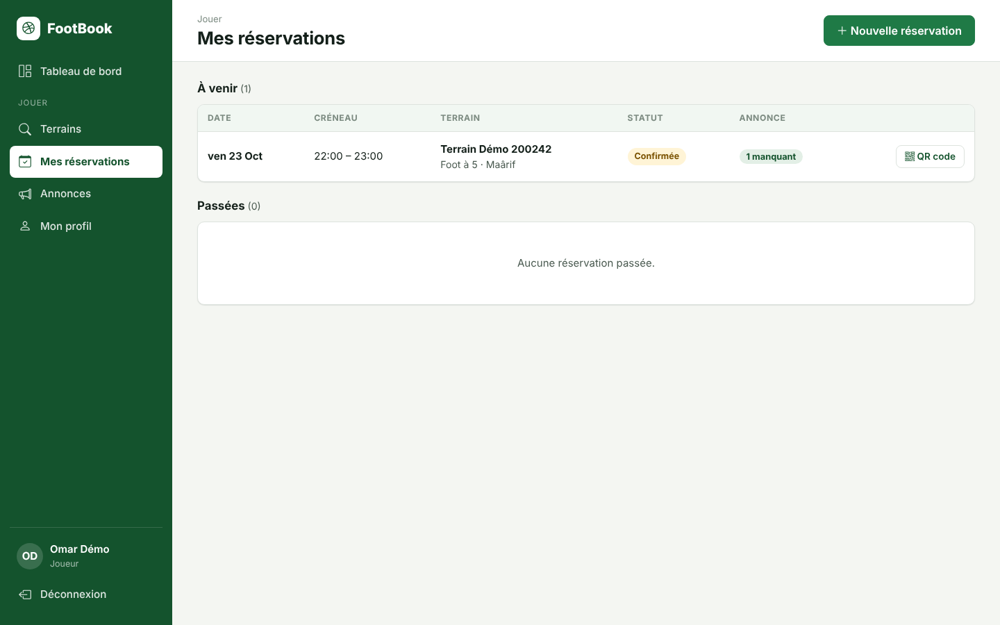

### Compléter son équipe : les annonces
- **Publier** : depuis le QR code ou *Mes réservations*, *Publier une annonce* ; indiquer le nombre de joueurs manquants (1 à 9 en 5V5, 13 en 7V7, 21 en 11V11) et un message. Une seule annonce par réservation.
- **Rejoindre** : *Annonces* liste les matchs qui cherchent des joueurs ; *Rejoindre* vous ajoute et retire une place. L'annonce disparaît quand l'équipe est complète ou quand le match est passé.

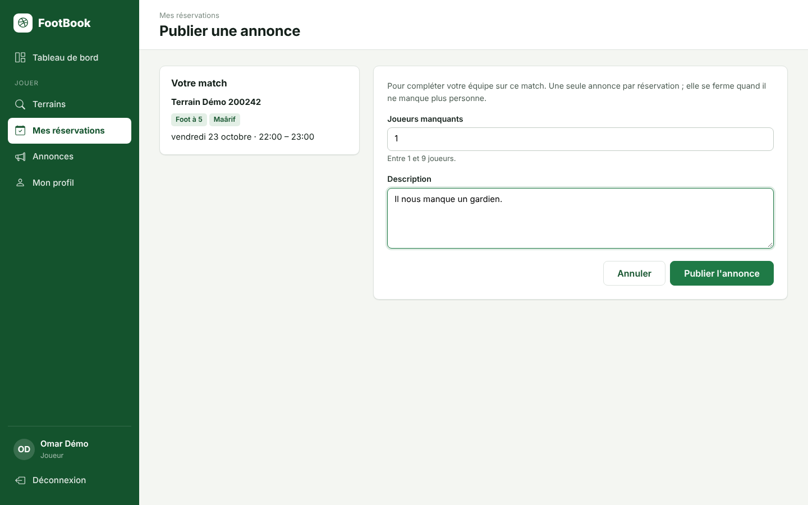
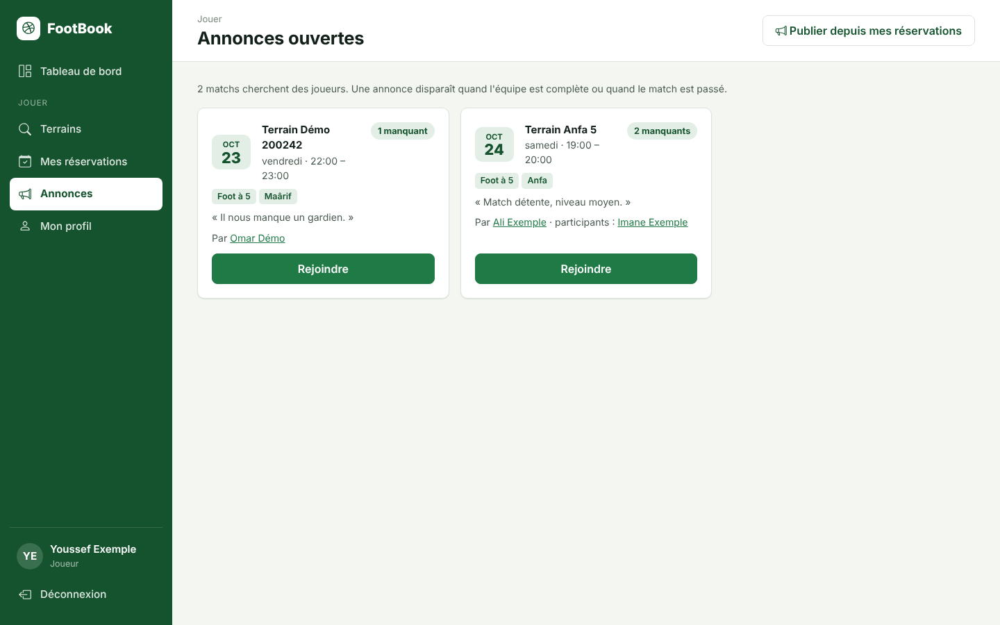

### Matchs joués et profil
Chaque fois que le propriétaire valide le QR code d'un match, votre compteur augmente de 1, ainsi que celui de chaque joueur qui avait rejoint l'annonce. Votre profil (nom, matchs joués, date d'inscription, annonces ouvertes) est visible des autres joueurs ; votre email ne l'est jamais.

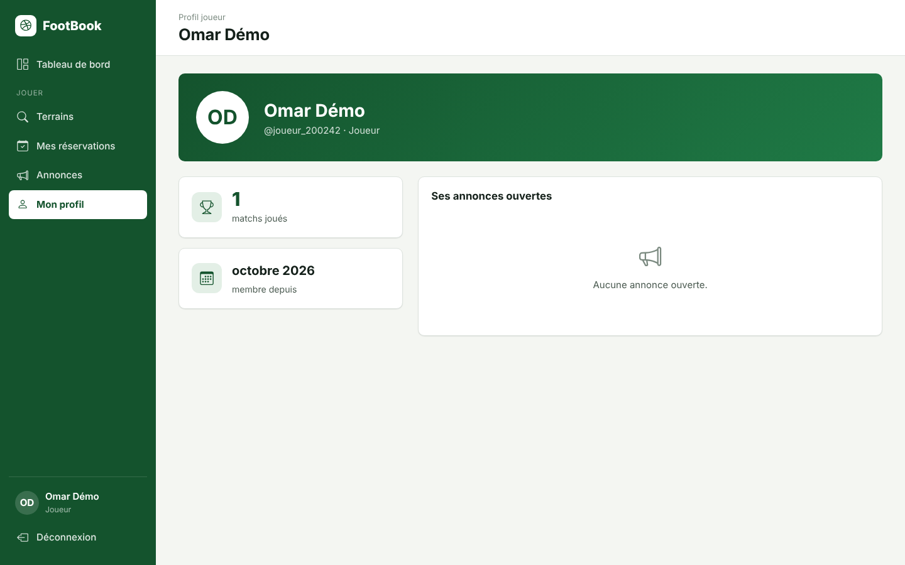

## Propriétaire

### Tableau de bord
Nombre de terrains, réservations à venir, QR codes validés, et les réservations du jour.

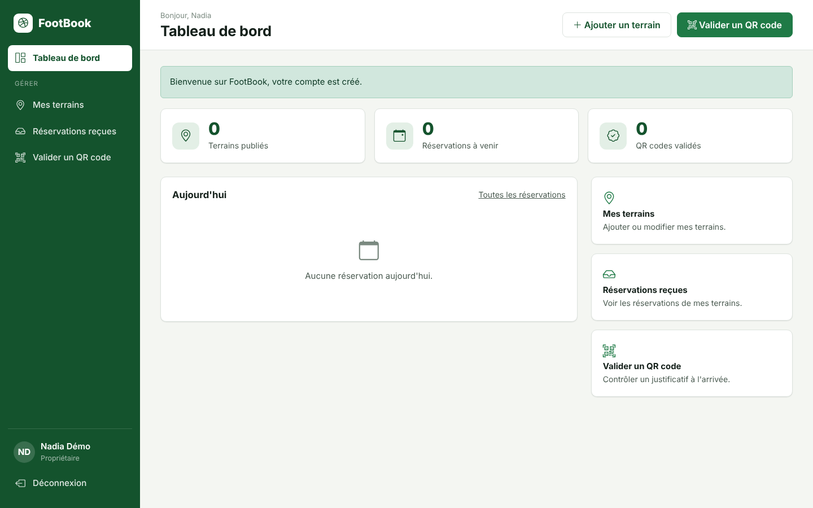

### Mes terrains
*Ajouter un terrain* : nom, prix par heure, catégorie, zone, adresse. Le prix doit être supérieur à 0 et deux de vos terrains ne peuvent pas porter le même nom. *Modifier* et *Supprimer* depuis le tableau (un terrain qui a déjà des réservations ne peut pas être supprimé).

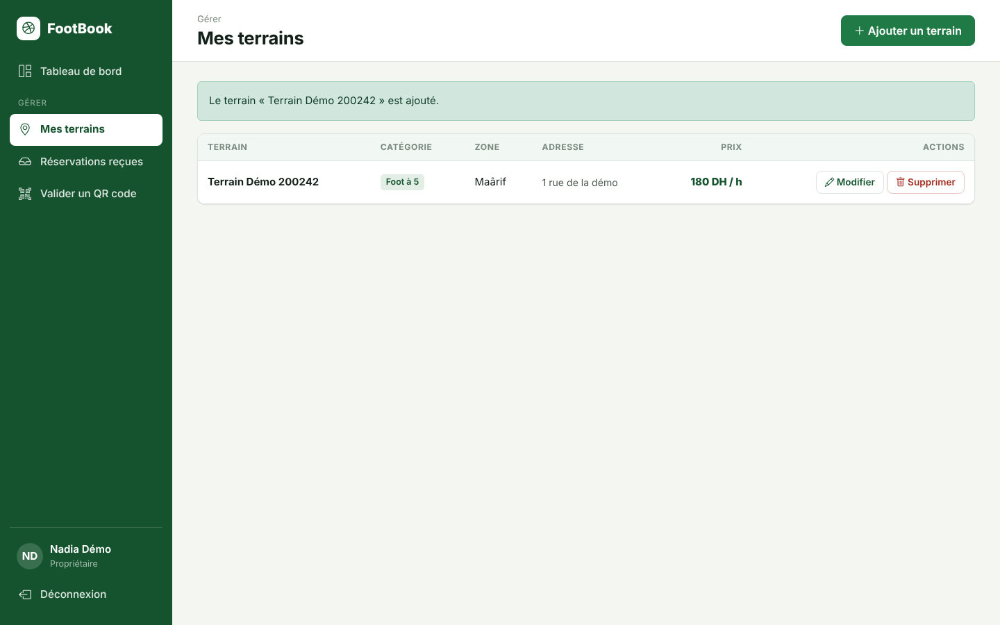

### Réservations reçues
Toutes les réservations de vos terrains : date, créneau, terrain, joueur, statut.

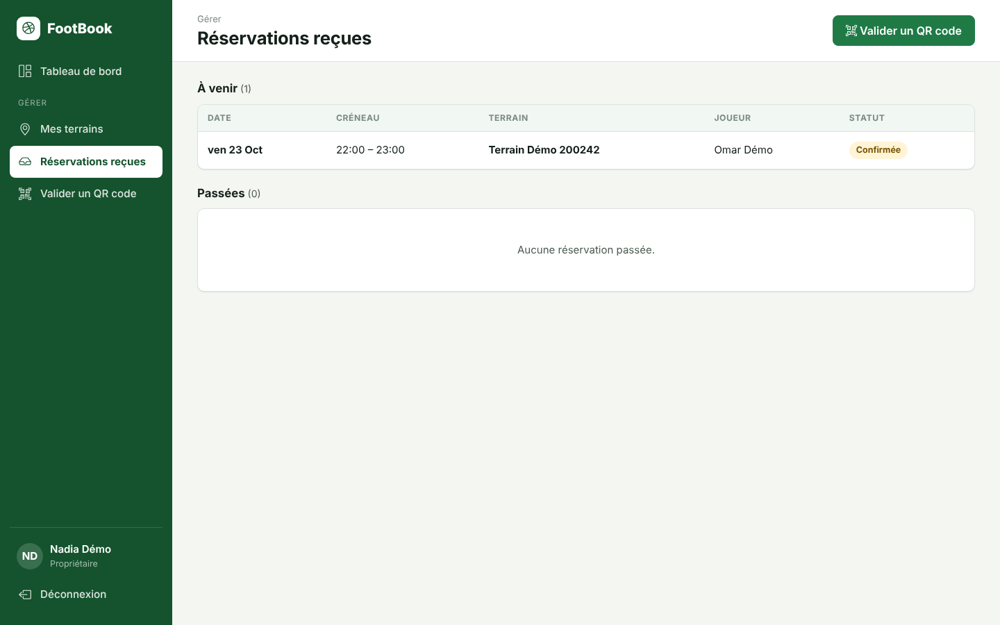

### Valider un QR code
Ouvrir *Valider un QR code* : la caméra s'ouvre (autoriser l'accès) ; viser le QR code du joueur, la validation est automatique. Sans caméra, coller le code texte dans *Saisie manuelle*.

- Validation réussie : nom du joueur, terrain et créneau s'affichent en vert.
- Un code déjà validé, inconnu, d'un autre propriétaire ou prévu un autre jour est refusé en rouge, et rien n'est modifié.

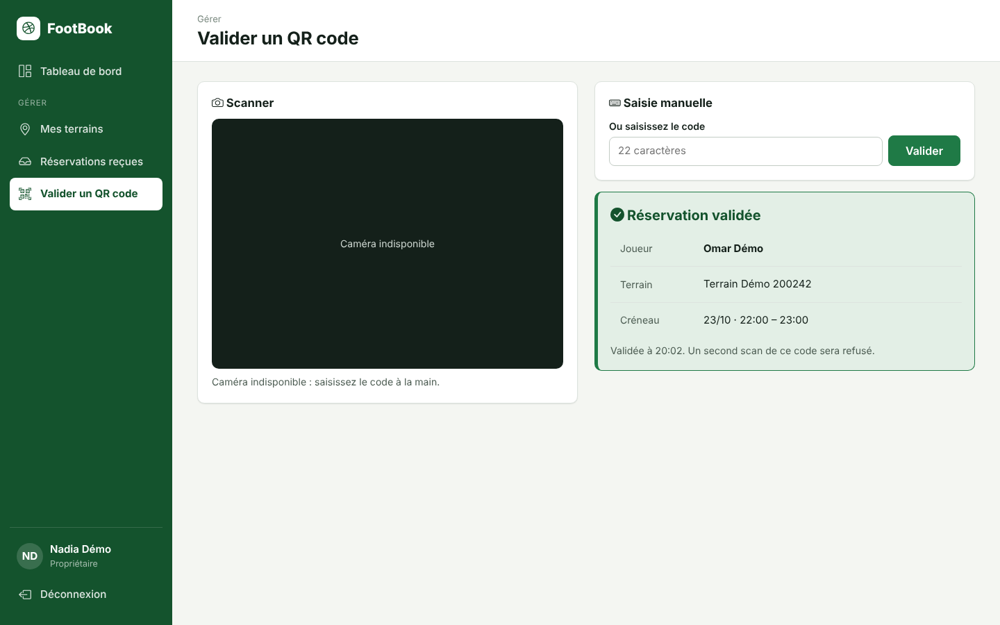
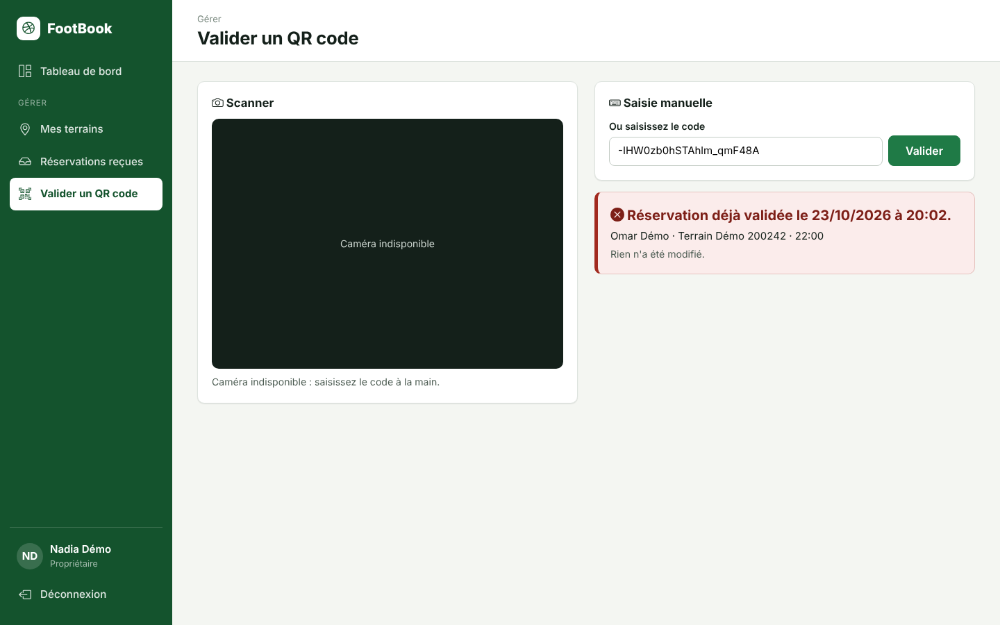
